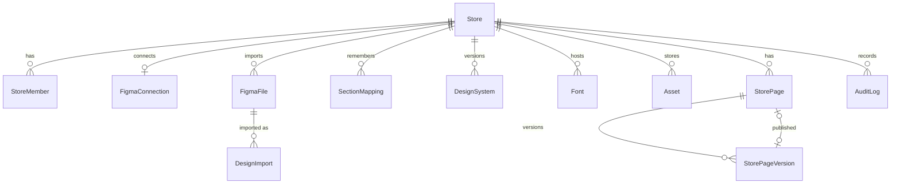

# Figma → NexEcoms: architecture

Figma is a design **source**. Imports are converted into NexEcoms-owned, validated, versioned page JSON; the
storefront renders that JSON and never calls Figma. Commerce data (products, collections, prices, cart) always comes
from the catalog.

## Modules

| Area | Code |
|---|---|
| Stores, flags, roles, isolation | `src/backend/lib/store.ts` (host → store, `FEATURE_THEMES`), `src/backend/lib/tenancy.ts` (`storeDb`, `systemDb`, `requireStoreRole`, `audit`) |
| Figma API | `src/backend/lib/figma/` — `client.ts` (token bucket, 429/5xx retry), `oauth.ts`, `crypto.ts` (envelope encryption), `connection.ts` (refresh, re-auth), `files.ts` (browse), `resync.ts` (webhooks, polling) |
| Links and plans | `src/shared/figma-url.ts`, `src/shared/design-plan.ts` (pairing, page types, Zod plan) |
| Pipeline | `src/backend/lib/design-import/` — `pipeline.ts` (queue + stages), `normalize.ts` (Figma → IR), `tokens.ts`, `mapping.ts`, `assets.ts`, `fonts.ts`, `storage.ts`, `diff.ts`, `install.ts` |
| Shared models | `src/shared/design-ir.ts`, `design-tokens.ts`, `sections/registry.ts` + `fields.ts` + `markup.ts`, `store-pages.ts`, `storefront.ts` |
| Pages | `src/backend/lib/store-pages.ts` (drafts, publish, rollback, checklist) |
| Storefront | `src/backend/lib/storefront.ts` (loader + catalog data), `src/app/_storefront/store-route.tsx`, `src/frontend/components/sections/*` (one file per section) |
| Admin | `src/frontend/views/admin/figma.tsx`, `design-import.tsx`, `design/*` (review, page editor, design system, media) |
| API | `src/backend/routes/design/*`, re-exported under `src/app/api/design/**` |

## Data model



Every store-owned table has `storeId` and is protected twice: `storeDb(storeId)` adds `storeId` to every query and
sets `app.store_id` in the same transaction; Postgres row level security (`store_isolation` policies, `FORCE`) only
returns rows of that store. `systemDb()` sets `app.bypass_rls` for the worker's job claim and webhook lookups only.
Header, footer and announcement bar are store pages with reserved slugs (`_header`, `_footer`, `_announcement`)
so they share versioning, publishing and rollback with other pages.

## Connect (OAuth)

```mermaid
sequenceDiagram
  actor Admin
  participant UI as Admin UI
  participant API as NexEcoms API
  participant DB as Postgres
  participant F as Figma
  Admin->>UI: Connect with Figma
  UI->>API: POST /api/design/figma/oauth/start (OWNER/ADMIN, CSRF-checked)
  API->>DB: FigmaOAuthState {sha256(state), PKCE verifier, store, user, session hash, +10 min}
  API-->>UI: authorize URL (scopes, state, S256 challenge)
  UI->>F: www.figma.com/oauth
  F-->>API: GET /api/design/figma/oauth/callback?code&state
  API->>DB: consume state (single use; user, session, store, expiry checked)
  API->>F: POST /v1/oauth/token (Basic auth, code_verifier)
  API->>F: GET /v1/me
  API->>DB: FigmaConnection (AES-256-GCM envelope-encrypted tokens) + AuditLog
  API-->>UI: 303 /admin?section=figma&figma=connected
```

## Import pipeline

```mermaid
sequenceDiagram
  actor Editor
  participant API
  participant Q as DesignImport (queue)
  participant W as Worker (in-process or scripts/design-worker.ts)
  participant F as Figma
  participant S as Storage (Cloudinary)
  Editor->>API: POST /api/design/imports (plan validated against the live file)
  API->>Q: QUEUED + after(): kick worker
  W->>Q: claim (UPDATE … FOR UPDATE SKIP LOCKED)
  W->>F: FETCHING — GET /v1/files/:key?depth=1, /nodes (batches of 5)
  W->>S: raw snapshot tenants/{store}/figma/{file}/{import}.json.gz
  W->>W: NORMALIZING — Figma nodes → IR (auto layout → flex, text runs, paints, effects, instances, links)
  W->>S: IR snapshot
  W->>W: TOKENS — styles + observed values, ΔE clustering, contrast, fonts
  W->>W: MAPPING — Section/<type> names → saved mappings → heuristics → freeform; responsive overrides; one h1
  W->>F: ASSETS — image fills, SVG + frame renders (fresh URLs)
  W->>S: SSRF-guarded download → sharp / svgo + DOMPurify → tenants/{store}/assets/{hash}; Google Fonts self-hosted
  W->>Q: REVIEW
  Editor->>API: review (change type, remap layers → SectionMapping), Install
  API->>API: StorePage + DRAFT StorePageVersion, DesignSystem (ACTIVE if none), never published
```

Each stage stores its output before advancing and skips itself when the output exists, so a crashed job resumes
where it stopped. Failures retry with exponential backoff (max 5 attempts); 4xx errors fail immediately.

## Edit, publish, render

```mermaid
sequenceDiagram
  actor Editor
  participant E as Page editor
  participant P as Preview iframe (/design-preview, signed token)
  participant API
  participant SF as Storefront
  Editor->>E: edit section settings (form generated from Zod schema)
  E->>P: postMessage(sections) — instant re-render
  E->>API: PUT draft {sections, revision} (debounced; 409 if stale)
  Editor->>E: Publish
  E->>API: GET checklist → POST publish (blocking: alt text, one h1, empty/broken links)
  API->>API: DRAFT → PUBLISHED, previous → ARCHIVED, cache cleared
  SF->>API: renderPage(host) → published version, globals, tokens, fonts, catalog data
  SF-->>SF: invalid sections skipped + logged; JSON-LD; CSS variables; srcset; CSP
```

## Re-sync

```mermaid
sequenceDiagram
  participant F as Figma
  participant API
  participant W as Worker
  actor Editor
  F->>API: webhook FILE_VERSION_UPDATE (passcode checked in constant time)
  Note over API,W: or polling GET /v1/files/:key/meta every 15 min when no webhook
  API->>API: FigmaFile.latestVersion → "Updates available"
  Editor->>API: Re-sync → RESYNC import (same frames and page types)
  W->>W: full pipeline → REVIEW
  Editor->>API: diff by figmaNodeId (added / removed / changed; overridden fields marked)
  Editor->>API: apply accepted changes → NEW draft version per page (+ draft design system if tokens accepted)
```

## Decisions

See `AUDIT.md` (tenancy on new tables, Postgres queue, Cloudinary, `StorePage` naming, bun test). Notable
implementation choices:

- **Rich text** is structured runs (bold/italic/underline/strike/link), edited as light markup; there is no HTML
  field anywhere, so "sanitizing" is schema validation and links are restricted to http(s)/mailto/tel/internal.
- **Shopify-style editing of Figma designs** (`src/shared/freeform-edit.ts`): exact pages are split into one
  section per horizontal band of the frame (layers that overlap vertically stay together; refused when the look would
  change or device designs don't pair up), so parts can be reordered, hidden or removed and library sections inserted
  between them. Inside a section the editor shows a layer tree: hide, delete, and, inside auto layout, duplicate and
  reorder; the inspector edits text, link, image and per-layer style overrides (`styles`, validated by
  `layerStyleSchema`). The preview iframe outlines on hover, selects on click (`nexecoms:select`) and edits text in
  place on double-click (`nexecoms:edit-text`).
- **Responsive overrides**: numeric/layout keys become per-breakpoint CSS variables; text and images use
  breakpoint-specific spans and `<picture>` sources.
- **Caching**: in-process memo keyed `tenant:{id}:page:{slug}:v{versionId}`, cleared on publish (no Redis).
- **Section code splitting**: `SECTION_COMPONENTS` loads each type on demand; most sections are server components
  and ship no JavaScript.
- **CSP** applies to the Figma storefront routes and previews; the theme storefront at `/` keeps its previous
  headers because imported theme templates may load third-party scripts.
